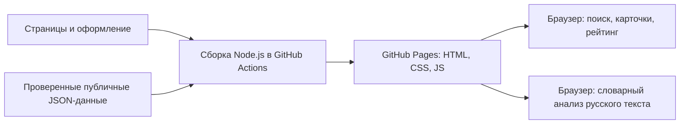

# Анализ проекта и переход к сайту

Проверка 14 октября 2026 года. Проанализированы страницы, браузерные модули,
сборщики, данные, NLP, база/импорт, тесты, инструкции и процессы GitHub Actions.

## Итоговая архитектура

Основной продукт — статический веб-сайт для GitHub Pages. Посетитель открывает
HTTPS-адрес в браузере, без установки программы. Владелец публикует изменения
через GitHub; Node.js запускается автоматически в Actions.

## Что было исправлено

| Область | Найденная проблема | Изменение |
|---|---|---|
| Документация | Основной сценарий начинался с установки Python на ПК | README и инструкции начинаются с сайта и GitHub Pages |
| Публичный интерфейс | Страница запуска предлагала desktop-сценарий | Страница содержит пошаговую публикацию сайта |
| Сборка | Pages требовал Flask, SQLite и Python-пакеты для экспорта | Основной сборщик использует Node.js и публичные JSON |
| Публикация | Ошибка Configure Pages останавливала даже сборку | Сборка и проверка выполняются отдельным заданием до публикации |
| Словарь | У Python и сайта могли расходиться определения | Общий `website/data/rules.json`, проверки совпадения |
| Подготовка данных | Повтор исходного URL с новым текстом увеличивал выборку | Дедупликация по физическому источнику и стабильному ID |
| Привязка к вузам | Один исходный отзыв мог учитываться у разных вузов | Конфликт отклоняет импорт целиком |
| Аудит | Проверенные по общему классу отзывы теряли очередь проверки тем | Добавлена отдельная очередь `audit --pending-aspects` |
| Даты | Отображение в Москве расходилось с UTC-фильтрами | Общий московский календарь дат и месяцев |
| Публичные данные | Закрытый текст мог оказаться в исходниках до редактирования сборщиком | В публичных JSON закрытые тексты и цитаты уже должны быть `null` |
| Замена сборки | Ошибка записи могла уничтожить предыдущий результат | Переименование с резервной копией и восстановлением |

## Состав проекта

| Файлы | Назначение | Нужны посетителю? |
|---|---|---|
| `templates/`, `static/` | Страницы и код сайта | Приходят как готовые веб-файлы |
| `website/data/` | Каталог, публичные отзывы, общий словарь | Сайт загружает подготовленный снимок |
| `scripts/build_website.mjs` | Основной сборщик | Нет; работает в Actions |
| `scripts/preview_website.mjs` | Необязательный просмотр сборки разработчиком | Нет |
| `package.json`, `package-lock.json` | Зафиксированные зависимости Node-сборки | Нет; устанавливаются в Actions |
| `.github/workflows/pages.yml` | Проверка, сборка и размещение сайта | Нет; работает на GitHub |
| `baknin/`, `app.py`, `model_training.py` | Дополнительные Python-инструменты, импорт, аудит и ML-обучение | Нет |
| `scripts/build_pages.py` | Дополнительный экспорт разрешённого снимка из SQLite | Нет; основной Pages workflow его не вызывает |
| `docs/` | Публикация, методика и проверки | Доступны владельцу проекта |

## Что сайт делает сам

Каталог, поиск и фильтры, карточки вузов, динамика, источники и рейтинг работают
по опубликованным данным. Анализ русского текста выполняется локально:
учитываются отрицания, три класса тональности и семь тем. Положительные и
отрицательные оценки разных тем сохраняются отдельно. У правил нет измеренной
вероятности; они всегда требуют проверки. Текст анализа не отправляется
на сервер и не добавляется к отзывам.

Сборщик разрешает только описанные публичные поля, проверяет источники и даты,
отклоняет произвольные служебные поля. Запрещённые к показу тексты нельзя
сохранять даже в исходном публичном JSON: Git хранит историю.

## Что ещё требует работы с данными

В комплекте пять вузов и **ноль реальных отзывов**. Нельзя считать это готовым
содержательным рейтингом или измеренной ML-системой. Для этого нужны разрешённые
источники, проверенный корпус, ручная разметка, оценка качества и калибровка
порогов. Сайт честно показывает «Недостаточно данных».

GitHub Pages обслуживает статические файлы. Постоянный Python API, приём новых
отзывов с серверной модерацией, пользовательские аккаунты и запуск `.joblib`
потребовали бы отдельного серверного хостинга; сейчас эти возможности не заявлены.

## Где опубликован сайт

Адрес проекта: `https://sweaty6.github.io/Baknin_Project/`.
Файлы и workflow в репозитории сами по себе не включают Pages. Владелец должен
выбрать Source: GitHub Actions в Settings → Pages. Подробные действия,
проверка зелёного результата и устранение 404 описаны в
[GITHUB_PAGES.md](GITHUB_PAGES.md). Размещение в интернете подтверждается
отдельной проверкой адреса после успешного deploy.
